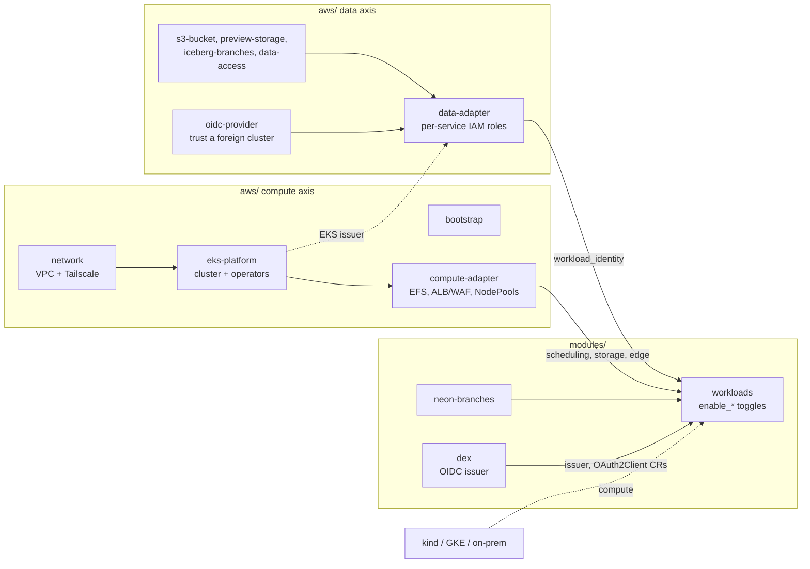

# lab-platform

[](https://github.com/Rosebud-Biosciences/lab-platform/actions/workflows/ci.yml)
[](https://github.com/Rosebud-Biosciences/lab-platform/releases)
[](LICENSE)

OpenTofu modules for running a data and ML platform on Kubernetes —
JupyterHub, Ray, Dagster, MLflow, Argo Workflows and a webapp, each behind an
`enable_*` toggle — with a **full preview environment for every pull
request**.

- **Previews on a shared cluster.** Each PR gets its own namespaces,
  copy-on-write branches of prod's databases, and either empty object and
  table stores or forks inside prod's own, made by
  [tether](https://github.com/Rosebud-Biosciences/tether). Reusable GitHub
  workflows stand them up and tear them down.
- **A portable core.** `modules/workloads` needs only the kubernetes and helm
  providers, so it runs on EKS, kind or any other cluster. Cloud specifics
  live in adapters, split into data and compute because data is harder to move
  than compute. AWS is the only backend today.
- **Login and tenancy.** One Dex issuer per cluster in front of your identity
  provider, Keycloak for tenants and delegated admins, and a login gate in
  front of every UI.
- **Guarded data.** The few resources that hold real data refuse an
  accidental `destroy`; everything else is disposable.

**Status:** beta, extracted from a production stack. Every module is checked
by `tofu validate` and plan-only `tofu test`, CI runs the workloads end to end
on kind, and a reference deployment runs the full preview loop on EKS.

## Quickstart

**On a laptop, free.** The workloads with Dex, Keycloak and two tenants on
kind, against local SeaweedFS and Postgres. Needs Docker and about 6 GiB of
memory.

```bash
cd examples/kind
scripts/up.sh             # cluster, prerequisites, apply, health checks (~8 min)
tofu output port_forwards
scripts/down.sh
```

**On AWS, about $225 a month.** A VPC, an EKS cluster and one webapp.

```bash
cd examples/minimal
cp terraform.tfvars.example terraform.tfvars   # set webapp_image and region
tofu init
tofu apply -target=module.network -target=module.platform   # first apply only: the cluster
tofu apply
```

To run your own app on the platform, start from the
[template app](https://github.com/Rosebud-Biosciences/lab-platform-template-app),
which wires these modules into CI, previews included.

## Examples

| Example | Runs on | Shows |
| --- | --- | --- |
| [`kind`](examples/kind) | a laptop or CI runner | every workload, OIDC login and tenants, on local data |
| [`kind-aws-data`](examples/kind-aws-data) | kind | a cluster outside AWS reaching AWS data with per-service roles and no static keys |
| [`minimal`](examples/minimal) | AWS | a VPC, a cluster and one webapp: the cheapest AWS path |
| [`complete`](examples/complete) | AWS | the full surface: monitoring, GPU, Ray, Tailscale, public and private ingress |
| [`jupyterhub`](examples/jupyterhub) | AWS | a multi-user lab with per-user and shared storage |
| [`preview`](examples/preview) | AWS | a preview environment per pull request on a shared cluster |
| [`ephemeral-ray`](examples/ephemeral-ray) | AWS | Argo and Dagster starting a throwaway Ray cluster per job |

## Modules

**Portable**, for any cluster:

| Module | What it is |
| --- | --- |
| [`modules/workloads`](modules/workloads) | The webapp, JupyterHub, Dagster, MLflow, Argo Workflows and Ray, each optional, stamped per environment |
| [`modules/neon-branches`](modules/neon-branches) | Copy-on-write Neon Postgres branches per preview |
| [`modules/dex`](modules/dex) | The cluster's OIDC issuer, brokering Google, GitHub, LDAP or SAML |
| [`modules/keycloak`](modules/keycloak) | The user store behind Dex: users, tenants, delegated admins |
| [`modules/keycloak-realm`](modules/keycloak-realm) | The platform realm: tenants as groups, superadmins, tenant and group admins |
| [`modules/tenancy`](modules/tenancy) | Which tenant runs where, checked against what each service can isolate |
| [`modules/postgres-group-roles`](modules/postgres-group-roles) | Per-group database logins for notebooks, scoped by the app's row-level security |
| [`modules/preview-access`](modules/preview-access) | What a preview's deploy identity may do: its own `preview-*` namespaces and nothing else |

**AWS data**, usable from any cluster:

| Module | What it is |
| --- | --- |
| [`aws/data-adapter`](aws/data-adapter) | Per-service IAM roles for S3, S3 Tables and ECR, trusting any OIDC issuer |
| [`aws/oidc-provider`](aws/oidc-provider) | Registers a cluster outside EKS with IAM |
| [`aws/s3-bucket`](aws/s3-bucket) | A hardened, KMS-encrypted bucket with ready-made policies |
| [`aws/preview-storage`](aws/preview-storage) | An ephemeral bucket per preview |
| [`aws/iceberg-branches`](aws/iceberg-branches) | An ephemeral Iceberg (S3 Tables) namespace per preview |
| [`aws/data-access`](aws/data-access) | A preview's access to prod's stores when tether forks them: write, never delete, never the trunk |
| [`aws/tenant-data`](aws/tenant-data) | One tenant's IAM role, storage and optional database |

**AWS compute**, an EKS cluster:

| Module | What it is |
| --- | --- |
| [`aws/bootstrap`](aws/bootstrap) | State bucket and locks, GitHub OIDC roles for CI and previews, an MFA-gated operator role |
| [`aws/network`](aws/network) | The VPC, with an optional Tailscale subnet router |
| [`aws/eks-platform`](aws/eks-platform) | The cluster and its operators: Karpenter, load balancers, DNS, monitoring, GPU, KubeRay, Tailscale |
| [`aws/compute-adapter`](aws/compute-adapter) | EFS for JupyterHub, ALB and WAF ingress, Karpenter NodePools |

`bootstrap`, `network` and `eks-platform` stand up the shared cluster once.
`workloads` and its adapters are applied once per environment, prod or
preview, each with its own `name_prefix`.

<details>
<summary>How the modules connect</summary>



</details>

## Documentation

- [Preview environments](docs/preview-environments.md): how previews work,
  the two data modes, and what a preview can reach.
- [Authentication and authorization](docs/auth.md): who may open which UI,
  and which login state branches with a preview.
- [Tenancy](docs/tenancy.md): running several tenants on one platform.
- [Persistent data and deletion guards](docs/persistent-data.md): what holds
  real data and how it is protected.
- [Operator access](docs/operator-access.md): the MFA-gated role that can
  disarm those guards.
- [Keeping versions current](docs/upgrades.md): Dependabot, the monthly
  chart-drift report, Tailscale clients.
- [Ephemeral Ray](docs/ephemeral-ray.md): a Ray cluster per job.

Each module's README documents its inputs and outputs.

## Cost

The baseline shared platform (`examples/minimal`, us-west-2, on demand) is
about $225 a month: the EKS control plane ($73), two `t3a.large` core nodes
($120) and one NAT gateway ($33). `examples/complete` adds monitoring, a NAT
gateway per zone, a persistent Ray cluster and GPU NodePools: expect hundreds
to low thousands a month. A preview adds only the pods and nodes it schedules.

## Requirements

- OpenTofu 1.12 or newer. The family is OpenTofu-only: its deletion guards
  use a dynamic `prevent_destroy`, which Terraform rejects.
- AWS provider 6.40 or newer, for the AWS modules.

## Security

Report vulnerabilities privately, as [SECURITY.md](SECURITY.md) describes.
Read it before running previews: a preview runs a pull request's code, and
it is confined to its own namespaces and data only from v0.3.0, with
`preview_access` configured.

## Contributing

[CONTRIBUTING.md](CONTRIBUTING.md) lists the six CI gates and how to run them
locally.

## License

[Apache-2.0](LICENSE). [NOTICE](NOTICE) names the copyright holder and the
adapted Helm values.
